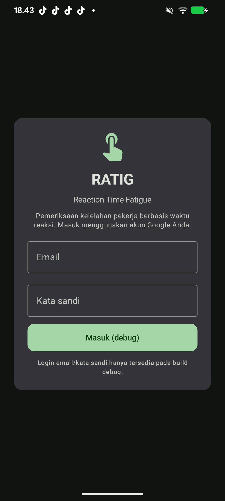
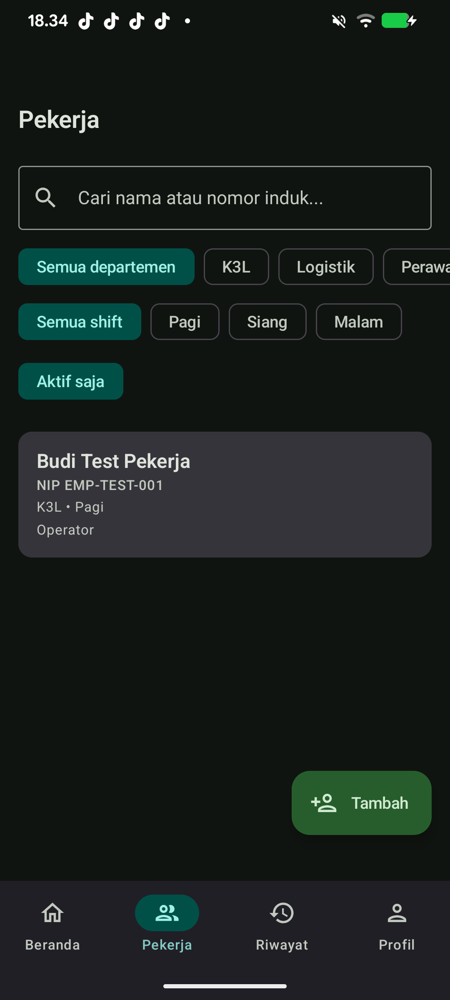
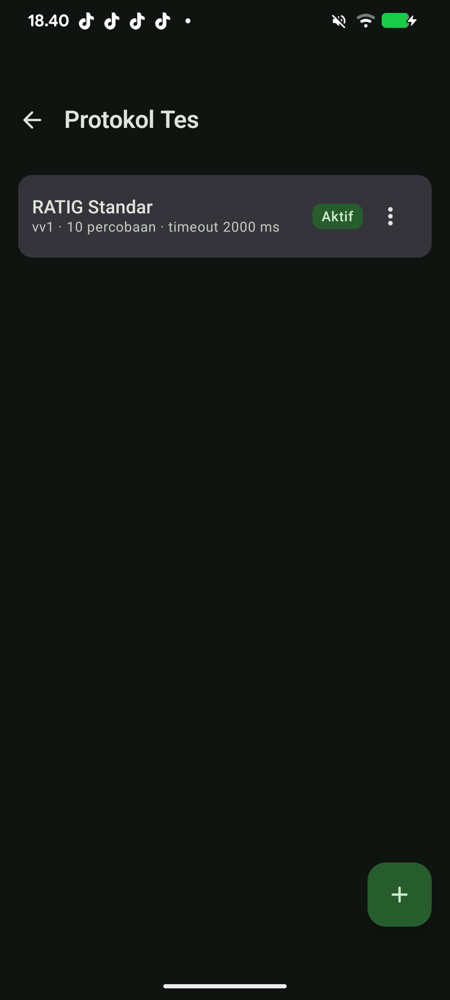
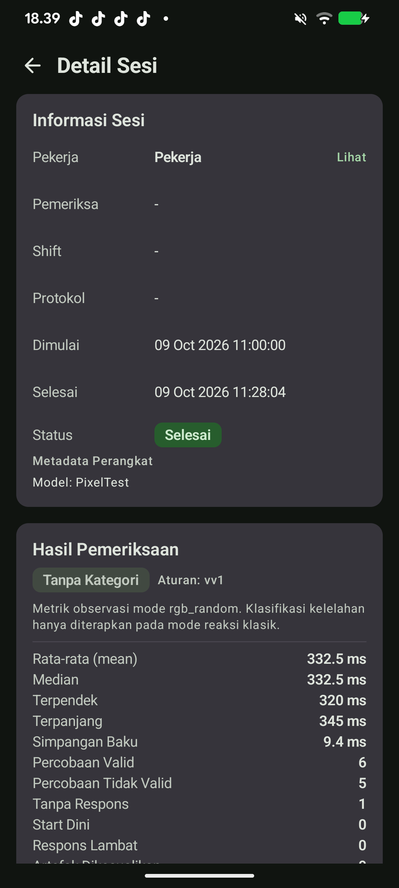
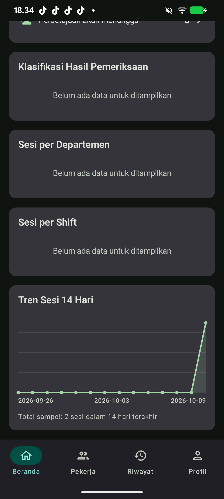

# RATIG — Buku Panduan Operasional

**Pemeriksaan Kelelahan Pekerja Berbasis Waktu Reaksi**

Buku kerja untuk petugas pemeriksa, administrator, dan pengelola sistem

Versi 1.0 · Android · 2026

Program Studi Informatika · Universitas Siliwangi

> **Alat bantu keputusan, bukan diagnosis medis.** Keputusan akhir tetap
> mengikuti SOP perusahaan dan penilaian pemeriksa yang berwenang.

<div class="page-break"></div>

## Tentang Buku Ini

Buku ini adalah panduan kerja, bukan manual teknis pengembangan. Isinya
disusun mengikuti urutan pekerjaan nyata:

1. menyiapkan perangkat dan akun;
2. memeriksa pekerja;
3. membaca hasil dan menindaklanjuti;
4. mengelola pengguna, jadwal, dan laporan;
5. merawat konfigurasi serta menangani masalah.

Setiap bab dapat dibaca berdiri sendiri. Untuk referensi teknis, lihat
`docs/architecture.md`; untuk naskah lengkap, lihat
`docs/manual/RATIG-Manual.pdf`.

## Cara Memakai Buku Ini

| Peran | Bab yang wajib dibaca |
|---|---|
| Petugas pemeriksa | 2, 4, 5, 6, 7, 13 |
| Admin | 2, 4, 8, 9, 10, 13 |
| Super Admin | 2, 9, 10, 11, 13 |
| Pengguna/pekerja | 2, 3, 7, 10, 13 |
| Pengembang/pengelola teknis | seluruh buku + `docs/deployment.md` |

<div class="page-break"></div>

## Daftar Isi

1. [Persiapan Harian](#1-persiapan-harian)
2. [Peran & Tanggung Jawab](#2-peran--tanggung-jawab)
3. [Perangkat, Setup, dan Login](#3-perangkat-setup-dan-login)
4. [Alur Pemeriksaan](#4-alur-pemeriksaan)
5. [Mode Tes & Protokol](#5-mode-tes--protokol)
6. [Membaca Hasil](#6-membaca-hasil)
7. [Riwayat & Tindak Lanjut](#7-riwayat--tindak-lanjut)
8. [Admin: Pengguna & Jadwal](#8-admin-pengguna--jadwal)
9. [Dasbor & Laporan](#9-dasbor--laporan)
10. [Super Admin: Konfigurasi](#10-super-admin-konfigurasi)
11. [Onboarding Tanpa Email Hosting](#11-onboarding-tanpa-email-hosting)
12. [Offline & Sinkronisasi](#12-offline--sinkronisasi)
13. [Pemecahan Masalah](#13-pemecahan-masalah)
14. [Checklist & Lembar Kerja](#14-checklist--lembar-kerja)
15. [Glosarium](#15-glosarium)

---

# 1. Persiapan Harian

Lakukan pemeriksaan singkat sebelum pekerja pertama datang.

## 1.1 Checklist perangkat

- [ ] Baterai minimal 60% atau perangkat terhubung daya.
- [ ] Kamera bersih dan izin kamera aktif.
- [ ] Tanggal & jam perangkat benar (zona waktu Asia/Jakarta).
- [ ] Aplikasi RATIG versi terbaru.
- [ ] Ruang penyimpanan cukup.
- [ ] Jaringan tersedia bila akan sinkronisasi; bila tidak, pastikan mode offline siap.

## 1.2 Checklist akun

- [ ] Akun petugas aktif.
- [ ] Protokol uji yang dipakai sudah aktif.
- [ ] Aturan klasifikasi sudah divalidasi (bukan “Perlu validasi”).
- [ ] Shift sesuai jadwal hari ini.
- [ ] Perangkat tidak memakai akun bersama tanpa pengawasan.

## 1.3 Checklist area

- [ ] Pencahayaan cukup; layar tidak memantulkan cahaya.
- [ ] Pekerja duduk nyaman dan tidak terganggu.
- [ ] Volume perangkat memadai untuk instruksi.
- [ ] Tidak ada percakapan yang mengganggu saat tes.

---

# 2. Peran & Tanggung Jawab

| Peran | Tanggung jawab utama | Batas |
|---|---|---|
| **Super Admin** | konfigurasi protokol, aturan, data master, akun admin, audit | tidak menggantikan keputusan medis |
| **Admin** | pekerja, pengguna biasa, jadwal, laporan, pemantauan | tidak mengubah konfigurasi atau mengangkat admin |
| **Pengguna** | menjalankan tes dan melihat riwayat sendiri | tidak melihat data pekerja lain |

“Satu orang, satu akun.” Jangan memakai akun petugas untuk pekerja, atau
sebaliknya. RLS di server membatasi data berdasarkan akun dan peran.

---

# 3. Perangkat, Setup, dan Login

## 3.1 Pertama kali

1. Pasang APK dari administrator.
2. Buka aplikasi.
3. Pilih bahasa, mode tampilan, dan ukuran tulisan.
4. Ketuk **Simpan & Lanjut**.
5. Ikuti panduan singkat.

Pengaturan dapat diubah dari **Profil → Pengaturan Tampilan**.

## 3.2 Login

1. Isi **Email / ID Login**.
2. Isi **Kata Sandi**.
3. Ketuk **Masuk**.

Email adalah ID login. Tidak perlu mailbox aktif. Untuk organisasi tanpa
hosting email, gunakan ID internal seperti `nama@ratig.local`.



**Gambar 1.** Login email/kata sandi.

## 3.3 Jika akun belum aktif

Akun dapat berstatus **Menunggu**. Hubungi Admin. Jangan membuat akun sendiri;
tidak ada pendaftaran mandiri.

---

# 4. Alur Pemeriksaan

## 4.1 Alur singkat

```
Pilih pekerja → pilih tes → baca instruksi → tes
      → tinjau hasil → finalisasi → sinkronkan
```

## 4.2 Langkah kerja

1. Buka **Pekerja**.
2. Cari pekerja berdasarkan nama/nomor induk atau pindai QR.
3. Ketuk pekerja → **Mulai Tes**.
4. Pilih jenis tes.
5. Pilih protokol dan shift.
6. Bacakan instruksi; pastikan pekerja memahami.
7. Jalankan tes tanpa gangguan.
8. Tinjau hasil lalu finalisasi.



**Gambar 2.** Daftar pekerja dan filter.

## 4.3 Saat tes berlangsung

- Jangan menutup aplikasi.
- Jangan berpindah aplikasi.
- Jangan mengarahkan jawaban pekerja.
- Catat kejadian luar biasa pada tindak lanjut.

> Jika sesi terputus, gunakan alur pemulihan yang tersedia. Jangan memaksa
> keluar saat proses finalisasi berjalan.

---

# 5. Mode Tes & Protokol

| Mode | Cocok untuk | Hasil |
|---|---|---|
| **Klasik (RGB)** | pemeriksaan standar | klasifikasi kelelahan |
| **Warna Acak** | variasi stimulus | metrik pengamatan |
| **Tombol Acak** | koordinasi mata–tangan | akurasi/kelalaian |
| **Fokus (Go/No-Go)** | kontrol impuls | akurasi/kelalaian |

Hanya mode Klasik yang dipakai untuk klasifikasi. Mode lain tidak digabung
menjadi satu skor.

## 5.1 Protokol

Protokol menentukan jumlah percobaan, delay stimulus, timeout respons, dan
konfigurasi tambahan. Super Admin dapat mengubah protokol dari menu
**Protokol Uji**.

- **Draf** — belum aktif.
- **Aktif** — dipakai untuk sesi baru.
- **Ditarik** — tidak dipakai lagi.

Perubahan pada protokol aktif disimpan pada versi yang sama. Layar edit
menampilkan peringatan. Catat alasan perubahan pada audit/tindak lanjut.



**Gambar 3.** Daftar protokol.

---

# 6. Membaca Hasil

| Istilah | Arti |
|---|---|
| Mean | rata-rata waktu reaksi |
| Median | nilai tengah |
| Std. Deviasi | sebaran respons |
| Percobaan valid | trial yang dihitung |
| Respons lambat | respons melewati ambang |
| Kategori | Normal / Ringan / Sedang / Berat |

Bila aturan belum divalidasi, hasil menampilkan **“Perlu validasi”**. Bila data
valid tidak cukup, menampilkan **“Data tidak cukup”**. Jangan menafsirkan
keduanya sebagai “Normal”.



**Gambar 4.** Detail hasil dan trial.

## 6.1 Eskalasi

- **Normal** — lanjutkan prosedur biasa.
- **Ringan/Sedang** — pertimbangkan istirahat, rotasi, atau pemeriksaan ulang
  sesuai SOP.
- **Berat** — ikuti prosedur eskalasi perusahaan; jangan membuat keputusan
  medis sendiri.
- **Perlu validasi / Data tidak cukup** — jangan memakai hasil untuk keputusan;
  hubungi Super Admin.

---

# 7. Riwayat & Tindak Lanjut

## 7.1 Riwayat

Menu **Riwayat** menampilkan sesi berdasarkan periode, shift, status, kategori,
dan nama pekerja.

Untuk peran **Pengguna**, riwayat hanya berisi sesi sendiri. Filter departemen
diganti informasi **Departemen Anda**.

## 7.2 Detail sesi

Berisi identitas pekerja, pemeriksa, shift, protokol, waktu, metrik, rincian
trial, dan tindak lanjut.

## 7.3 Tindak lanjut

1. Buka detail sesi.
2. Pilih **Tambah Tindak Lanjut**.
3. Tulis tindakan yang dilakukan.
4. Tetapkan status (terbuka/selesai).
5. Simpan.

Tindak lanjut adalah catatan operasional, bukan diagnosis.

---

# 8. Admin: Pengguna & Jadwal

## 8.1 Menambah pengguna

Buka **Profil → Pengguna → (+)**.

| Kolom | Keterangan |
|---|---|
| Nama lengkap | wajib |
| ID Login | email atau `nama@ratig.local` |
| Peran | Admin hanya boleh membuat Pengguna |
| Status | aktif atau menunggu |
| Kata sandi sementara | min. 8 karakter; wajib |

Tidak ada email undangan. Berikan ID dan sandi langsung kepada pengguna.

## 8.2 Menonaktifkan pengguna

Gunakan menu pengguna → nonaktifkan. Riwayat pekerja tidak dihapus. Akun yang
nonaktif tidak bisa masuk.

## 8.3 Jadwal & shift

- Super Admin mengelola **shift** di Data Master.
- Admin/Super Admin mengatur jadwal pemeriksaan.
- Bila halaman jadwal kosong, belum ada jadwal yang dibuat; itu bukan error.
- Worker hanya melihat jadwal, tidak dapat mengubahnya.

---

# 9. Dasbor & Laporan

## 9.1 Dasbor Admin

Menampilkan pekerja aktif, total pengguna, sesi hari ini/total, sesi belum
selesai, tindak lanjut terbuka, akun menunggu, klasifikasi hasil, sebaran
departemen/shift, dan tren.



**Gambar 5.** Grafik dasbor.

Jika grafik kosong: belum ada sesi final, atau pekerja belum memiliki
departemen. Itu bukan kegagalan aplikasi.

## 9.2 Laporan

1. Buka **Profil → Laporan**.
2. Pilih periode dan filter.
3. Pratinjau.
4. Ekspor CSV dan bagikan.

---

# 10. Super Admin: Konfigurasi

## 10.1 Protokol

Buat/ubah protokol, aktifkan draf, atau tarik protokol aktif. Menu **Ubah**
tersedia untuk semua status.

## 10.2 Aturan klasifikasi

Atur ambang dan label kategori. Validasi aturan sebelum dipakai untuk keputusan.
Aturan yang belum valid akan menampilkan “Perlu validasi”.

## 10.3 Data master

Kelola departemen, area kerja, dan shift. Perubahan data master memengaruhi
filter dan laporan.

## 10.4 Audit log

Audit log mencatat pembuatan akun, perubahan peran, persetujuan, dan perubahan
konfigurasi. Gunakan untuk menelusuri perubahan.

---

# 11. Onboarding Tanpa Email Hosting

## 11.1 Pekerja

1. Buka **Pekerja → (+)**.
2. Isi NIP dan nama.
3. Isi kata sandi (min. 8).
4. Email boleh kosong → ID login `<NIP>@ratig.local`.
5. Simpan; berikan ID dan sandi langsung.

## 11.2 Pengguna/Admin

1. Buka **Profil → Pengguna → (+)**.
2. Isi nama, ID Login, sandi sementara.
3. Simpan; akun langsung aktif.
4. Berikan kredensial langsung.

> Email hanyalah pengenal unik. Tidak ada email yang dikirim, jadi tidak perlu
> hosting email.

---

# 12. Offline & Sinkronisasi

1. Tes tetap berjalan tanpa sinyal.
2. Data disimpan di perangkat.
3. WorkManager mengirim otomatis saat online.
4. Buka **Status Sinkronisasi** untuk melihat antrean.
5. **Sinkronkan sekarang** memaksa pengiriman.

| Status | Arti |
|---|---|
| Menunggu koneksi | tersimpan lokal |
| Sedang disinkronkan | sedang dikirim |
| Tersinkronisasi | diterima server |
| Gagal, akan dicoba | gangguan sementara |
| Perlu pemeriksaan | perlu tindakan admin |

Server tetap sumber kebenaran; hasil final tidak dapat diubah dari perangkat.

---

# 13. Pemecahan Masalah

| Gejala | Yang dilakukan |
|---|---|
| Tidak bisa login | cek ID/sandi, status akun, jaringan |
| Tambah pekerja ditolak | NIP/email duplikat atau sandi < 8 |
| Tambah pengguna ditolak | ID login sudah dipakai atau sandi < 8 |
| QR tidak dikenali | format `RATIG1:<NIK>` atau input manual |
| Kamera tidak muncul | izin kamera di Pengaturan Android |
| Data belum terkirim | buka Status Sinkronisasi; cek jaringan |
| Grafik kosong | belum ada sesi final/departemen |
| “Perlu validasi” | aturan belum divalidasi; hubungi Super Admin |
| Hasil terputus | lanjutkan sesi atau ulangi; jangan paksa keluar |

---

# 14. Checklist & Lembar Kerja

## 14.1 Checklist sebelum tes

- [ ] Pekerja yang benar sudah dipilih.
- [ ] Protokol sesuai.
- [ ] Shift sesuai.
- [ ] Instruksi sudah dibacakan.
- [ ] Pekerja memahami dan setuju.
- [ ] Lingkungan tenang.

## 14.2 Checklist setelah tes

- [ ] Hasil ditinjau.
- [ ] Trial tidak wajar diperiksa.
- [ ] Kategori dibaca bersama konteks.
- [ ] Tindak lanjut dicatat bila perlu.
- [ ] Sesi difinalisasi.
- [ ] Sinkronisasi diperiksa.

## 14.3 Lembar catatan harian

| Jam | Nama pekerja | NIP | Mode | Hasil | Tindakan |
|---|---|---|---|---|---|
|  |  |  |  |  |  |
|  |  |  |  |  |  |
|  |  |  |  |  |  |
|  |  |  |  |  |  |
|  |  |  |  |  |  |

## 14.4 Checklist demo presentasi

1. Login Super Admin; tunjukkan dasbor.
2. Buka Pekerja → detail → Mulai Tes; jelaskan 4 mode.
3. Buka Riwayat → detail hasil/trial.
4. Buka Protokol → Ubah; jelaskan versi.
5. Buka Pengguna → (+) Tambah Pengguna; jelaskan sandi tanpa email.
6. Buka Audit Log.
7. Login Pengguna; tunjukkan Riwayat “Departemen Anda”.
8. Tutup dengan batasan: alat bantu keputusan, bukan diagnosis.

---

# 15. Glosarium

| Istilah | Arti |
|---|---|
| PVT | Psychomotor Vigilance Task; tes waktu reaksi |
| Monotonic clock | jam yang tidak terpengaruh perubahan waktu sistem |
| RLS | Row Level Security; pembatasan baris data |
| Room | database lokal Android |
| WorkManager | penjadwal sinkronisasi |
| Immutable | tidak dapat diubah setelah final |
| Audit log | catatan tindakan penting |

---

## Lampiran — Akun Demo

Kata sandi: **`Ratig-T3st-2026!`** (hanya lingkungan uji).

| Email | Peran |
|---|---|
| `admin@ratig.test` | Super Admin |
| `examiner@ratig.test` | Admin |
| `mgmt@ratig.test` | Admin |
| `worker@ratig.test` | Pengguna |

> Ganti/hapus akun demo sebelum produksi.

---

*RATIG — sederhana bagi pengguna, kuat di belakang layar.*
