# RATIG — Buku Manual Pengguna

**Sistem Pemeriksaan Kelelahan Pekerja Berbasis Waktu Reaksi**

Versi 1.0 · Android · 2026

Program Studi Informatika · Universitas Siliwangi

> **RATIG adalah alat bantu keputusan.** Hasil pemeriksaan bukan diagnosis
> medis dan bukan keputusan akhir kelayakan kerja. Keputusan tetap mengikuti
> SOP perusahaan dan penilaian pemeriksa yang berwenang.

<div class="page-break"></div>

## Kata Pengantar

Buku ini menjelaskan cara memasang, mengoperasikan, dan merawat RATIG untuk
kebutuhan pemeriksaan kelelahan pekerja. Panduan disusun untuk petugas
pemeriksa, administrator, dan pengelola sistem — bukan hanya untuk pengembang.

Prinsip yang dipakai sepanjang buku:

1. **Sederhana di permukaan, ketat di belakang.** Alur tes dibuat sesingkat
   mungkin; keamanan dan integritas data ditangani server.
2. **Tidak mengarang data.** Bila aturan klasifikasi belum divalidasi, aplikasi
   menampilkan “Perlu validasi”, bukan angka yang menyesatkan.
3. **Offline-first.** Tes tetap berjalan tanpa sinyal; sinkronisasi menyusul.
4. **Satu orang, satu akun.** Pekerja dan pemeriksa memiliki akun masing-masing
   dengan hak akses berbeda.

---

## Daftar Isi

1. [Mengenal RATIG](#1-mengenal-ratig)
2. [Persyaratan & Pemasangan](#2-persyaratan--pemasangan)
3. [Setup Awal & Login](#3-setup-awal--login)
4. [Peran & Hak Akses](#4-peran--hak-akses)
5. [Mengelola Pekerja](#5-mengelola-pekerja)
6. [Alur Pemeriksaan](#6-alur-pemeriksaan)
7. [Memahami Hasil](#7-memahami-hasil)
8. [Riwayat & Tindak Lanjut](#8-riwayat--tindak-lanjut)
9. [Dasbor & Laporan](#9-dasbor--laporan)
10. [Konfigurasi Super Admin](#10-konfigurasi-super-admin)
11. [Offline & Sinkronisasi](#11-offline--sinkronisasi)
12. [Onboarding Tanpa Email Hosting](#12-onboarding-tanpa-email-hosting)
13. [Keamanan & Privasi](#13-keamanan--privasi)
14. [Pemecahan Masalah](#14-pemecahan-masalah)
15. [Glosarium](#15-glosarium)
16. [Lampiran](#16-lampiran)

---

# 1. Mengenal RATIG

RATIG (*Reaction Time Fatigue*) mengukur **waktu reaksi** pekerja sebagai
indikator kelelahan. Pemeriksaan dilakukan di perangkat Android, hasil muncul
seketika, dan data dapat dipantau oleh administrator.

## 1.1 Masalah yang diselesaikan

- Kelelahan sering tidak terlihat secara subjektif.
- Pemeriksaan manual lambat dan sulit dibandingkan antarwaktu.
- Catatan kertas/spreadsheet sulit diaudit dan dipantau per departemen/shift.

## 1.2 Kemampuan utama

| Kemampuan | Penjelasan |
|---|---|
| Empat mode tes | Klasik, Warna Acak, Tombol Acak, Fokus Go/No-Go |
| Klasifikasi | Berdasarkan aturan yang disetujui organisasi |
| Identifikasi | NIK manual atau QR/barcode; NIK disamarkan |
| Offline-first | Room + WorkManager; tes tetap jalan tanpa sinyal |
| Tiga peran | Super Admin, Admin, Pengguna |
| Keamanan | RLS server-side, hasil final immutable, audit log |
| Pemantauan | Dasbor, tren, klasifikasi, per departemen/shift, ekspor CSV |

## 1.3 Batasan

RATIG tidak menggantikan pemeriksaan medis, tidak mendiagnosis penyakit, dan
tidak menetapkan kelayakan kerja secara otomatis. Aplikasi juga bukan sistem
IoT dan tidak memerlukan perangkat keras khusus.

---

# 2. Persyaratan & Pemasangan

## 2.1 Perangkat

| Komponen | Kebutuhan |
|---|---|
| Sistem | Android 8.0 (API 26) atau lebih baru |
| Kamera | Untuk pemindai QR/barcode (opsional) |
| Penyimpanan | ±100 MB ruang kosong |
| Jaringan | Opsional; diperlukan untuk sinkronisasi |
| Akun | Dibuat administrator; tidak ada pendaftaran mandiri |

## 2.2 Pemasangan

1. Terima berkas APK dari administrator.
2. Buka berkas, izinkan pemasangan dari sumber tepercaya bila diminta.
3. Setelah terpasang, buka **RATIG**.
4. Pada pemakaian pertama, ikuti **Setup Awal**.

> Jangan memasang APK dari sumber tidak dikenal. Aplikasi tidak meminta akses
> kamera sebelum pemindai dibuka.

---

# 3. Setup Awal & Login

## 3.1 Setup Awal

Saat pertama dibuka, aplikasi menampilkan tiga pilihan dengan pratinjau
langsung:

1. **Bahasa** — Bahasa Indonesia atau English.
2. **Mode Tampilan** — Ikut Ponsel, Terang, atau Gelap.
3. **Ukuran Tulisan** — Normal, Besar, atau Sangat Besar.

Ketuk **Simpan & Lanjut**. Pengaturan dapat diubah lagi dari
**Profil → Pengaturan Tampilan**.

## 3.2 Login

1. Isi **Email / ID Login**.
2. Isi **Kata Sandi**.
3. Centang **Ingat saya** bila perangkat dipakai sendiri.
4. Ketuk **Masuk**.

> Email di sini adalah **ID login**, bukan harus mailbox aktif. Organisasi tanpa
> hosting email dapat memakai ID internal seperti `nama@ratig.local`.

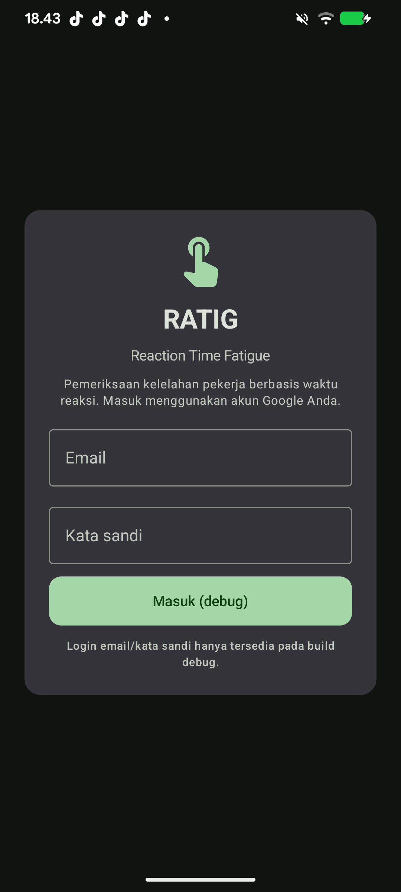

**Gambar 1.** Layar login email/kata sandi.

## 3.3 Status akun

- **Aktif** — dapat langsung masuk.
- **Menunggu** — perlu persetujuan Admin.
- **Nonaktif** — hubungi Admin.

---

# 4. Peran & Hak Akses

| Peran | Halaman | Wewenang |
|---|---|---|
| **Super Admin** | Dasbor Super Admin | konfigurasi sistem, protokol, aturan, data master, akun admin, audit |
| **Admin** | Dasbor Admin | pekerja, pengguna biasa, jadwal, tindak lanjut, laporan, pemantauan |
| **Pengguna** | Beranda Pengguna | tes, riwayat sendiri, profil |

Pembatasan ditegakkan **di server** dengan Row Level Security:

- Admin tidak dapat mengubah protokol/aturan/data master.
- Admin tidak dapat mengangkat pengguna menjadi admin.
- Admin tidak dapat membuat akun admin.
- Pengguna hanya melihat sesi miliknya.

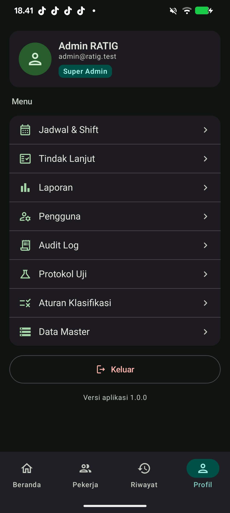

**Gambar 2.** Menu Profil Super Admin. Menu konfigurasi tidak muncul untuk Admin.

---

# 5. Mengelola Pekerja

## 5.1 Menambah pekerja

Buka **Pekerja → (+) Tambah**.

| Kolom | Wajib | Keterangan |
|---|---|---|
| Nomor Induk Pekerja | Ya | 4–32 digit; tidak boleh duplikat |
| Nama Lengkap | Ya | tampil di daftar |
| Email login | Tidak | boleh `nama@ratig.local` |
| Kata Sandi Login | Tidak | min. 8 karakter |
| Departemen / Area / Shift | Tidak | area mengikuti departemen |
| Jabatan | Tidak | contoh: Operator |

Dua kemungkinan hasil:

- **Sandi diisi** — data pekerja + akun login dibuat sekaligus; akun langsung
  aktif. Email kosong → ID login `<nomor-induk>@ratig.local`.
- **Sandi kosong** — hanya data pekerja; tidak ada akun login.

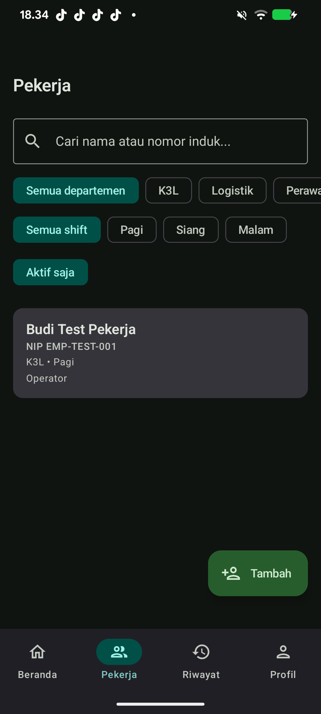

**Gambar 3.** Daftar pekerja dengan pencarian dan filter.

## 5.2 Mencari pekerja

- Ketik nama/nomor induk pada kolom pencarian.
- Filter departemen, shift, atau status aktif.
- Pindai QR `RATIG1:<NIK>` bila kartu pekerja tersedia.

## 5.3 Detail pekerja

Ketuk pekerja untuk melihat:

- identitas dan NIK tersamar;
- departemen, area, shift, jabatan;
- tombol **Mulai Tes**;
- riwayat pemeriksaan pekerja tersebut.

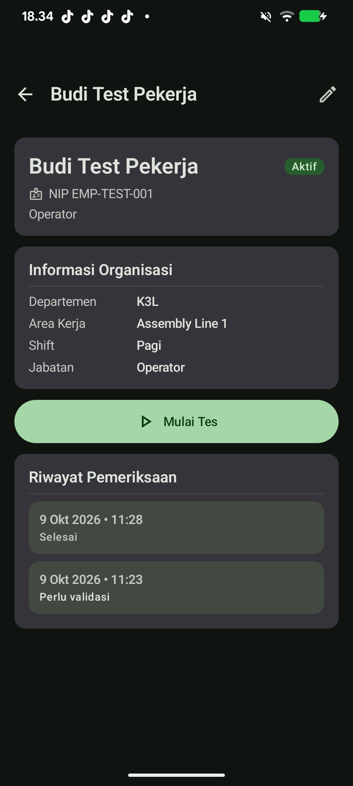

**Gambar 4.** Detail pekerja dan tombol Mulai Tes.

---

# 6. Alur Pemeriksaan

## 6.1 Ringkasan

```
Pilih pekerja → pilih jenis tes → baca instruksi → tes
      → tinjau hasil → finalisasi → sinkronkan
```

## 6.2 Langkah rinci

1. Buka **Pekerja** dan pilih pekerja.
2. Ketuk **Mulai Tes**.
3. Pilih jenis tes:
   - **Tes Kelelahan Standar (Klasik/RGB)** — hasil diklasifikasi.
   - **Warna Acak** — metrik pengamatan.
   - **Tombol Acak** — koordinasi mata–tangan.
   - **Fokus (Go/No-Go)** — kontrol impuls.
4. Pilih **Protokol** dan **Shift** bila diminta.
5. Bacakan instruksi; centang pemahaman pekerja.
6. Jalankan tes. Jangan menutup aplikasi atau berpindah aplikasi.
7. Tinjau hasil dan finalisasi.

> Jika sesi terputus, data yang sudah final tetap aman. Jangan memaksa keluar
> saat proses finalisasi berjalan.

## 6.3 Empat mode

| Mode | Fokus | Hasil |
|---|---|---|
| Klasik (RGB) | kecepatan reaksi | **klasifikasi kelelahan** |
| Warna Acak | reaksi terhadap warna acak | metrik pengamatan |
| Tombol Acak | pencarian target | akurasi/kelalaian |
| Fokus (Go/No-Go) | inhibisi respons | akurasi/kelalaian |

Hanya mode Klasik yang dipakai untuk klasifikasi; mode lain tidak digabung
menjadi satu skor.

---

# 7. Memahami Hasil

| Istilah | Arti |
|---|---|
| Mean | rata-rata waktu reaksi (ms) |
| Median | nilai tengah |
| Std. Deviasi | sebaran respons |
| Percobaan valid | trial yang dihitung |
| Respons lambat | respons melewati ambang |
| Kategori | Normal / Fatigue Ringan / Sedang / Berat |

Bila aturan belum divalidasi, kategori menampilkan **“Perlu validasi”**.
Bila data valid tidak cukup, menampilkan **“Data tidak cukup”**.

## 7.1 Skrining paramedis

Dari layar hasil, petugas dapat mencatat:

- tekanan darah sistolik/diastolik;
- nadi;
- kadar alkohol.

Aplikasi menampilkan temuan dan rekomendasi. Nilai kosong tidak dianggap
normal. Rekomendasi tetap saran; keputusan ada pada pemeriksa.

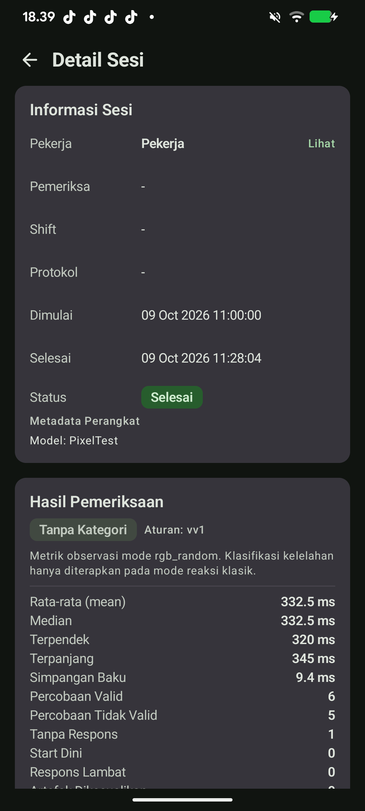

**Gambar 5.** Detail hasil, metrik, dan rincian trial.

---

# 8. Riwayat & Tindak Lanjut

## 8.1 Riwayat

Menu **Riwayat** menampilkan sesi berdasarkan:

- periode: semua / 7 / 30 / 90 hari;
- shift, status, kategori;
- pencarian nama pekerja.

Untuk peran **Pengguna**, riwayat otomatis hanya berisi sesi sendiri; filter
departemen diganti informasi **Departemen Anda**.

## 8.2 Detail sesi

Ketuk sesi untuk melihat:

- pekerja, pemeriksa, shift, protokol, waktu;
- metrik dan kategori;
- rincian trial per nomor;
- tindak lanjut.

## 8.3 Tindak lanjut

Admin dapat membuat catatan tindak lanjut, menetapkan status, dan menutup
temuan. Gunakan menu **Tindak Lanjut** atau bagian bawah detail sesi.

---

# 9. Dasbor & Laporan

## 9.1 Dasbor Admin

Menampilkan:

- pekerja aktif, total pengguna, sesi hari ini/total;
- sesi belum selesai, tindak lanjut terbuka, akun menunggu;
- klasifikasi hasil;
- sesi per departemen dan shift;
- tren 14 hari.

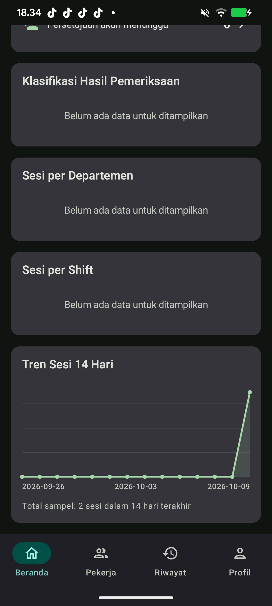

**Gambar 6.** Grafik klasifikasi, departemen/shift, dan tren.

## 9.2 Laporan

1. Buka **Profil → Laporan**.
2. Pilih periode dan filter.
3. Pratinjau lalu ekspor CSV.
4. Bagikan berkas melalui dialog berbagi Android.

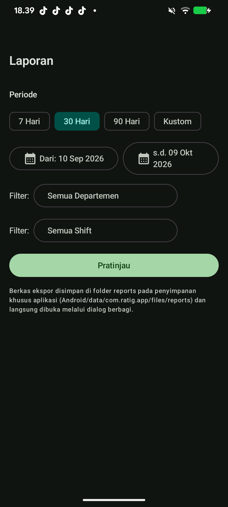

**Gambar 7.** Halaman laporan dan ekspor.

---

# 10. Konfigurasi Super Admin

## 10.1 Protokol Uji

- **Ubah** tersedia untuk semua status protokol.
- Untuk protokol **Aktif**, perubahan disimpan pada versi yang sama dan
  berlaku untuk sesi baru. Layar edit menampilkan peringatan.
- **Aktifkan** hanya untuk draf; **Tarik** untuk protokol aktif.

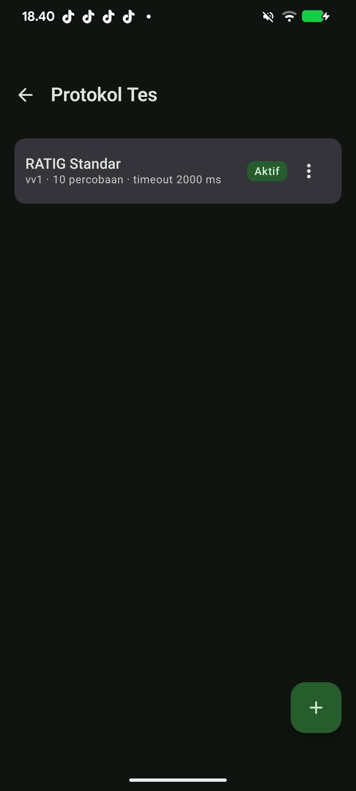

**Gambar 8.** Daftar protokol.

## 10.2 Aturan klasifikasi

Atur ambang kategori, severity, dan validasi aturan. Label dan ambang harus
sesuai SOP organisasi.

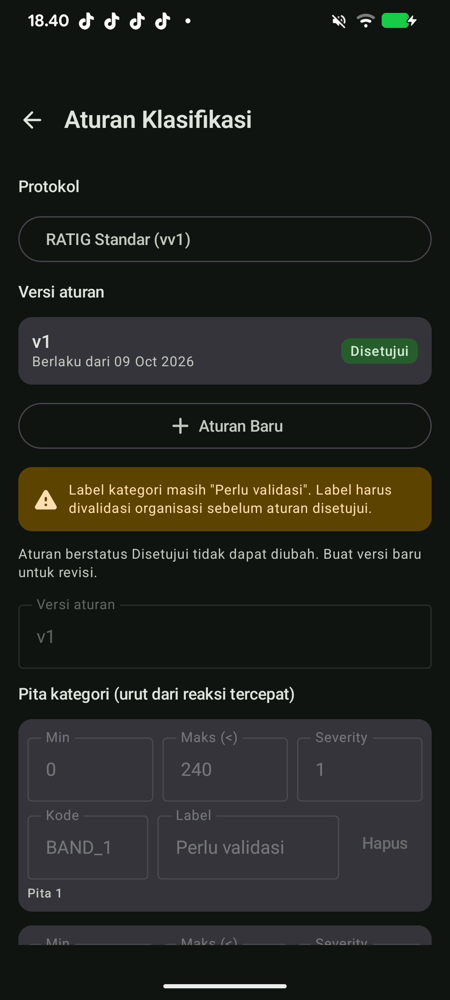

**Gambar 9.** Aturan klasifikasi.

## 10.3 Data master

Kelola departemen, area kerja, dan shift. Data ini dipakai untuk
mengelompokkan pekerja dan laporan.

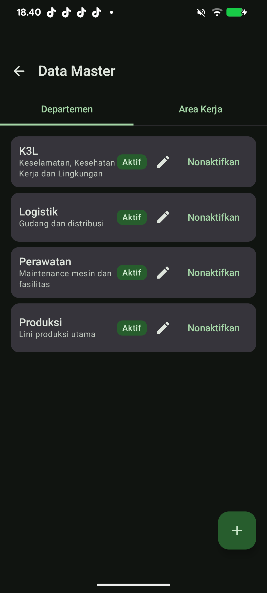

**Gambar 10.** Data master.

## 10.4 Audit log

Audit log mencatat tindakan penting: pembuatan akun, perubahan peran,
persetujuan, dan perubahan konfigurasi.

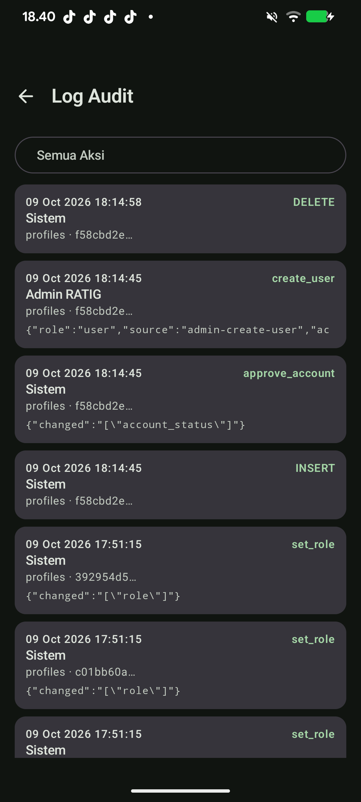

**Gambar 11.** Audit log.

---

# 11. Offline & Sinkronisasi

1. Tes tetap berjalan tanpa sinyal.
2. Data disimpan di Room di perangkat.
3. WorkManager mengirim data saat online.
4. Buka **Status Sinkronisasi** untuk melihat antrean.
5. **Sinkronkan sekarang** memaksa pengiriman segera.

| Status | Arti |
|---|---|
| Menunggu koneksi | tersimpan lokal |
| Sedang disinkronkan | sedang dikirim |
| Tersinkronisasi | diterima server |
| Gagal, akan dicoba | gangguan sementara |
| Perlu pemeriksaan | perlu tindakan admin |

> Server tetap sumber kebenaran. Hasil final tidak dapat diubah dari perangkat.

---

# 12. Onboarding Tanpa Email Hosting

Tidak perlu mail server atau undangan email.

## 12.1 Pekerja

1. Buka **Pekerja → (+)**.
2. Isi NIP, nama, dan kata sandi.
3. Kosongkan email → ID login `<NIP>@ratig.local`.
4. Simpan; berikan ID + sandi langsung.

## 12.2 Pengguna/Admin

1. Buka **Profil → Pengguna → (+)**.
2. Isi nama, **ID Login** (boleh `nama@ratig.local`), dan sandi sementara.
3. Simpan; akun langsung aktif.
4. Sampaikan kredensial langsung.

> Email hanyalah pengenal unik. Tidak ada email yang dikirim, sehingga
> mailbox/hosting email tidak diperlukan.

---

# 13. Keamanan & Privasi

- NIK ditampilkan disamarkan.
- Foreign key memakai UUID, bukan NIK.
- Service-role key tidak pernah disimpan di APK.
- RLS membatasi akses berdasarkan peran dan kepemilikan sesi.
- Hasil final immutable.
- Audit log mencatat tindakan penting.
- Skrining kesehatan disimpan lokal pada perangkat versi ini.

---

# 14. Pemecahan Masalah

| Gejala | Solusi |
|---|---|
| Tidak bisa login | cek ID/sandi, status akun, dan jaringan |
| Tambah pekerja ditolak | NIP/email duplikat atau sandi < 8 karakter |
| Tambah pengguna ditolak | ID login sudah dipakai atau sandi < 8 karakter |
| QR tidak dikenali | gunakan format `RATIG1:<NIK>` atau input manual |
| Kamera tidak muncul | izinkan kamera di Pengaturan Android → RATIG → Izin |
| Data belum terkirim | buka Status Sinkronisasi; cek jaringan; sinkronkan |
| Grafik kosong | belum ada sesi final/klasifikasi/departemen |
| “Perlu validasi” | aturan klasifikasi belum divalidasi; hubungi Super Admin |
| “Koneksi jaringan bermasalah” | periksa DNS/jaringan perangkat |
| Hasil terputus | lanjutkan sesi atau ulangi; jangan paksa keluar saat finalisasi |

---

# 15. Glosarium

| Istilah | Arti |
|---|---|
| **PVT** | Psychomotor Vigilance Task; tes waktu reaksi |
| **Monotonic clock** | jam yang tidak terpengaruh perubahan waktu sistem |
| **RLS** | Row Level Security; pembatasan baris data di PostgreSQL |
| **Edge Function** | fungsi server untuk operasi sensitif (pembuatan akun, ekspor) |
| **Room** | database lokal Android |
| **WorkManager** | penjadwal sinkronisasi latar belakang |
| **Immutable** | tidak dapat diubah setelah final |
| **Audit log** | catatan tindakan penting |

---

# 16. Lampiran

## 16.1 Akun demo

Kata sandi: **`Ratig-T3st-2026!`** (hanya lingkungan uji).

| Email | Peran |
|---|---|
| `admin@ratig.test` | Super Admin |
| `examiner@ratig.test` | Admin |
| `mgmt@ratig.test` | Admin |
| `worker@ratig.test` | Pengguna |

## 16.2 Berkas terkait

- `docs/guidebook/RATIG-Guidebook.pdf` — ringkasan operasional.
- `docs/poster/RATIG-Poster.pdf` — poster ilmiah A2.
- `docs/demo/RATIG-Demo-Penggunaan.mp4` — demo penggunaan.
- `USER-MANUAL.md` — manual pengguna versi ringkas.

## 16.3 Dukungan

Hubungi administrator teknis atau pengelola sistem RATIG di organisasi Anda.
Sertakan versi aplikasi, model perangkat, dan tangkapan layar bila melaporkan
masalah.

---

*RATIG — sederhana bagi pengguna, kuat di belakang layar.*
